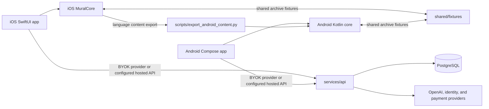

# Mural Project Knowledge Base

**Snapshot:** `main` at `607c3bb` (2026-10-18); `origin/main` was fetched and matched this commit on 2026-10-21. The working tree was clean before this file was added. This is a navigation and context document, not a substitute for checking current source or production configuration.

## Mental model

Mural is a local-first language-learning product with two native clients and a separate API foundation. iOS and Android implement their own UI, audio, persistence, and learning core. Swift is the source for language-module content; Android gets generated language content plus a hand-maintained Kotlin port of shared learning behavior. The API owns account identity, hosted access, funding ledgers, commerce, and provider-side session settlement when those features are configured.



The public website is in the separate `Chuloo/mural-website` repository.

## Repository map

| Path | Role |
| --- | --- |
| `apps/ios/App/` | SwiftUI application, conversation coordination, WebRTC transport, API clients, account flows, and SwiftData persistence |
| `apps/ios/Core/` | Platform-independent Swift learning models, policy, languages, evidence, recall, archive, and session logic; built as `MuralCore` |
| `apps/ios/Tests/`, `apps/ios/UITests/` | Core and native UI coverage |
| `apps/android/app/src/main/java/chat/mural/ui/` | Compose screens and visual system |
| `apps/android/app/src/main/java/chat/mural/` | `MainActivity`, `MuralViewModel`, `LearningRepository`, and voice service |
| `apps/android/app/src/main/java/chat/mural/core/` | Kotlin port of learning and account-domain behavior, kept JVM-testable |
| `apps/android/app/src/main/java/chat/mural/network/` | OpenAI/API clients, WebRTC transport, credentials, account sessions, and billing adapters |
| `shared/contracts/`, `shared/fixtures/` | JSON contracts and cross-platform golden data |
| `services/api/src/` | Fastify API, authentication, hosted voice, minutes, commerce, provider adapters, diagnostics, and operations |
| `services/api/migrations/`, `services/api/operations/` | Ordered PostgreSQL schema migrations and restricted runtime grants/support SQL |
| `scripts/` | Android language export, cross-platform checks, Xcode project generation, release validators, and operations utilities |
| `docs/` | Build, architecture, setup, language, account, minute, and Android design guides |
| `release/`, `verification/` | Store materials, dated release evidence, operational records, and validation reports; many files are historical snapshots |

## Product and data boundaries

- The normal practice path uses the learner's own OpenAI API key. The key is stored in Keychain on iOS or encrypted with Android Keystore on Android; it is not part of learning backups.
- Conversations, vocabulary, preferences, and learning evidence stay on the device. Mural does not save raw audio. Audio, selected conversation text, learning context, and requested searches can be sent to OpenAI. `store: false` where supported does not mean the provider has no retention.
- Account sessions are separate from the OpenAI key and from local learning history. An account does not imply hosted voice or purchases are active.
- Usage displays are estimates. A client-side time limit is not a provider billing cap. For hosted sessions, the server must rely on verified provider closure/usage evidence; elapsed time or client-reported usage cannot settle a balance.
- The backend keeps money accounting (nanoUSD) and conversation-time accounting (integer milliseconds) separate. Grants, reservations, settlement, refunds, and corrections are journaled; existing ledger entries are not edited in place.

## Learning model and cross-platform rules

### Language modules

`apps/ios/Core/Languages/LanguageModule.swift` owns `LanguageRegistry.all`. Current `main` registers 13 learning modules:

| ID | Learning target | Module locale |
| --- | --- | --- |
| `nb` | Norwegian Bokmål, Eastern Norwegian speech target | `nb-NO` |
| `es` | Spanish from Spain | `es-ES` |
| `en` | International English | `en` |
| `fr` | French from France | `fr-FR` |
| `de` | Standard German from Germany | `de-DE` |
| `it` | Italian from Italy | `it-IT` |
| `pt` | Brazilian Portuguese | `pt-BR` |
| `zh` | Standard Mandarin, Simplified Chinese | `zh-CN` |
| `sr` | Standard Serbian, Ekavian, Latin-script teaching target | `sr-Latn-RS` |
| `el` | Modern Standard Greek from Greece | `el-GR` |
| `tl` | Tagalog/Filipino from the Philippines | `tl-PH` |
| `nl` | Standard Dutch from the Netherlands | `nl-NL` |
| `ru` | Standard Russian | `ru-RU` |

Meaning/subtitle languages are a separate list from learning modules. The API preserves `en-US` for older-client compatibility in addition to the current module locale `en`.

Each module supplies a stable ID, locale, greeting, regional speech and writing guidance, lemma rules, staged teaching focus, lookup fallback, and cultural theme overrides. `Themes.swift` owns the shared catalog of 24 theme IDs. Each conversation is tied to a language ID; vocabulary keys and progress are language-scoped. Switching language invalidates pending language-dependent work and does not mix history or evidence.

The exporter reads the Swift registry and language files to generate Android `core/Languages.kt`. The rest of the learning core is ported by hand. `scripts/check_cross_platform.py` compares model prompts, selected numeric constants, and required archive fields. Golden fixtures in `shared/fixtures/cross-platform/` exercise decoding/projection on both clients. These checks do not establish equal speech recognition, pronunciation, or native UI behavior.

When adding or changing a language, read `docs/add-language.md` and `docs/language-architecture.md`. Update the Swift registry/module, regenerate Android language content, update API locale admission and tests, keep manually mirrored prompts/rules aligned, and add cross-platform fixtures and relevant UI checks. Published language IDs are persistent data identifiers; do not silently repurpose one.

### Local records and backups

- iOS wraps learning persistence in `apps/ios/App/Storage.swift` and `LearningStore`; the app uses SwiftData without CloudKit.
- Android persists its archive through `LearningRepository` to a private `learning.json` using `AtomicFile`; its separate account and API-key stores do not go in the learning archive.
- The shared JSON archive is schema version 2. Version 1 data migrates to Norwegian (`nb`). Dates use Apple's reference epoch (2001-01-01). Exports are semantically compatible; JSON key ordering is not guaranteed to match.
- Import validates before merging, keeps local settings, and rejects invalid/unknown-language data. The documented file limit is 30 MB. iOS keeps a protected pre-migration payload copy in Application Support.

## Native app architecture

### iOS

`MuralApp.swift` constructs the SwiftData container and `RootView`. `RootView.swift` holds the main Talk, Themes, and Words navigation plus settings and sheets. `ConversationCoordinator.swift` coordinates language/theme selection, voice lifecycle, typed replies, helper requests, assessment, lookup, hosted access, and persistence. `LiveTransport.swift` owns WebRTC and provider event transport; it can create a hosted lease through the API client when that provider path is selected. `APIClient.swift` handles direct helper calls and hosted API calls. Account identity/session logic lives in the `ManagedAccount*` and `Hosted*` files.

The iOS target is documented for Xcode 26+ and iOS 26.1+. Its core package is `apps/ios/Package.swift`; Core files are auto-discovered. App files and Xcode settings are assembled by `scripts/generate_project.py`. After adding/removing app files, use the generator and preserve `apps/ios/Config/Local.xcconfig`, signing team, and bundle identity. iOS pins `stasel/WebRTC` 152.0.0; preserve the bundled third-party notices and SDK privacy manifest when changing dependencies.

### Android

`MainActivity.kt` sets up permissions and activity lifecycle. `MuralViewModel.kt` owns conversation/UI state, limits, cancellation, assessment, meanings, and save behavior. `LearningRepository.kt` owns the local archive. `VoiceConversationService.kt` keeps a live voice call available in the background and exposes the ongoing notification/end action. UI is split into Compose files in `ui/`; network and platform adapters live in `network/`.

Android is a separate app: Java 17, Gradle 8.11.1, AGP 8.10.1, Kotlin 2.1.20, compile/target SDK 36, minimum API 26, and `webrtc-sdk` 150.7871.01. `apps/android/app/build.gradle.kts` contains build-time gates for API origin, account config, purchase channel/environment, and special verification variants. Do not infer feature availability from a source class alone; check the build config and server flags together.

## API and hosted commerce

`services/api/` is a Node.js 22.19+ TypeScript service using Fastify and PostgreSQL (`pg`). `src/main.ts` validates environment/configuration, constructs provider/service adapters and workers, then starts the app. `src/app.ts` owns HTTP route wiring, request admission/rate limits, safe errors, and health/capability responses. Domain logic is split into small `src/*` modules. The migrations are ordered and the adjacent `operations/*runtime-grants.sql` files scope database privileges for deployed runtime roles.

Route families include:

- health/readiness/pricing;
- auth challenge/exchange, account profile, linking/sign-out/deletion, and access admission;
- guest and member minute balances, welcome grants, guest transfer, and operator grants;
- hosted live sessions, close/recovery, teaching helpers, and feedback/reporting;
- Stripe, Apple, Google Play, and website purchase/order/webhook paths, with provider verification and durable fulfillment;
- a legacy sandbox dollar-credit path retained for compatibility.

Configuration is deliberately fail-closed. `services/api/.env.example`, `main.ts`, minute-commerce config, and build configuration define gates. A route or provider adapter in source does not show that production enables it. Root README/API README and dated verification records describe different historical points; production status must be checked from the actual deployed revision and current config before any rollout or operational change. Follow root `AGENTS.md` for backup, active-call, compatibility, deployment, and verification requirements.

### Private self-hosted web app

`apps/web/` is a React 19 + TypeScript + Vite single-page app. In production, Caddy serves the built static app and proxies `/v1` to the Fastify API; Vite proxies those API paths during local development. The web experience is owner-only through Google sign-in (`MURAL_WEB_OWNER_EMAIL`) and persists web conversations and vocabulary in the API's PostgreSQL database. The API's `/v1/web/*` routes are in `src/web-routes.ts`.

Text can use SIWC credentials imported from the user's laptop with `scripts/siwc-login.mjs` and the `web-admin` command, or an explicitly configured OpenAI-compatible endpoint. Provider secrets are encrypted with `MURAL_SECRETS_ENCRYPTION_KEY`. Hosted voice stays disabled unless the server has `OPENAI_API_KEY` and `HOSTED_VOICE_EXPERIMENTAL=true`; `MURAL_LIVE_MODEL` selects the Live model (default `gpt-live-1`). Web voice tracks up to 200 reserved/charged minutes per UTC calendar month at the checked-in $0.05/min rate, separately from an existing minute balance. This is an app-side time cap, not an OpenAI billing limit. Migration `036_private_web.sql` adds the web data and voice-period records. See `docs/web-app.md` before self-hosting; local build verification does not establish that production configuration or deployment is ready.

The API README documents local commands and a deployment wrapper, but its activation instructions include historical guidance. Do not copy old values into production. Keep database credentials, provider keys, signing keys, private configuration, and local `.env` files out of Git and logs. API diagnostics use an opaque request reference and safe category rather than request bodies, tokens, transcripts, or raw provider errors.

## Working conventions and constraints

- Fetch `origin/main` at the start of Mural coding work. Do not create a branch unless explicitly requested. Preserve dirty/untracked work; use an isolated worktree if an update could put it at risk.
- Keep the Talk screen minimal. Put funding-boundary explanation and Continue/New conversation choices together in one native sheet; dismissal preserves the conversation, and the microphone may reopen the pending choice. Use the existing orange primary action and native patterns. Do not add a logo/splash stage before Android's animated Talk orb.
- For native UI work, trace whether the experience depends on API contracts, error responses, prompts, flags, migrations, or runtime grants. If an authorized release requires matching server behavior, root `AGENTS.md` requires a compatible backend deployment and live verification before calling the release complete.
- Preserve local learning data, app IDs, signing identity, and third-party notices. Do not put API keys or account credentials in app resources, logs, or backups.
- iOS Xcode signing is machine-specific; ignored `Config/Local.xcconfig` and local signing keys must be preserved. Android `local.properties`, signing keys, and build output are also local.
- The API and web app use pnpm with checked-in lockfiles; the API pins pnpm 11.21.0. Keep types for directly imported packages in the API's direct dev dependencies; pnpm's isolated dependency layout exposes undeclared imports that npm hoisting could mask. Run API commands from `services/api/` and web commands from `apps/web/`. Android uses Gradle; iOS uses Swift Package Manager/Xcode.
- CI runs Swift Core tests, API typecheck/build/tests with isolated PostgreSQL, Python script tests and cross-platform checks, plus Android build/lint/unit/UI checks. Live device/provider checks are separate and can use billable provider calls; distinguish them from offline test evidence.

## Useful commands

Run from the repository root unless noted:

```sh
swift test --package-path apps/ios
python3 -m unittest discover -s scripts/tests -t .
python3 scripts/export_android_content.py --check
python3 scripts/check_cross_platform.py
```

From `apps/android/`:

```sh
./gradlew :app:testDebugUnitTest :app:lintDebug :app:assembleDebug
```

From `services/api/`:

```sh
corepack enable
pnpm install --frozen-lockfile
pnpm run check
pnpm run build
pnpm test
```

From `apps/web/`:

```sh
pnpm install --frozen-lockfile
pnpm run build
```

The API's PostgreSQL integration tests require a separate disposable test database (documented as a database ending in `_test`). Never point them at production. See `docs/build-and-test.md` for full native and live-device workflows; live verification is not part of routine offline checks.

## Documentation map and known drift

- Start at `README.md`, `docs/repository-layout.md`, `docs/language-architecture.md`, and `docs/build-and-test.md`. For the private web app, see `docs/web-app.md`.
- Use `docs/add-language.md` for language changes, `docs/run-on-iphone.md` / `docs/run-on-android.md` for setup, `docs/conversation-minutes.md` and `docs/manage-free-minutes.md` for funding semantics, and `services/api/README.md` plus `services/api/docs/` for server contracts/operations.
- Use `release/` and `verification/` for evidence, but treat dated files as snapshots rather than current production state.
- Several docs are stale relative to current code: `docs/android/design.md` describes eight modules and says background calls end, while current code registers 13 modules and `VoiceConversationService` supports background calls; `README.md`, `apps/android/README.md`, and the language architecture table also have outdated language-count claims or omit Dutch and Russian. Source registry and current implementation are authoritative; update the affected docs when making relevant product changes.
- The initial repository familiarization covered the architecture, entry points, scripts, CI, and operational docs. A private web app has since been added; its web and API production builds passed from temporary copies. Tests, Docker builds, and live production inspection were not run. No credentials were created and no deployment was performed.

## Fast entry points by task

| If the next change is about… | Start here |
| --- | --- |
| Talk, onboarding, settings, screens | `apps/ios/App/RootView.swift`, `apps/android/app/src/main/java/chat/mural/ui/`, `AGENTS.md` |
| Voice lifecycle, audio, background behavior | `apps/ios/App/ConversationCoordinator.swift`, `apps/ios/App/LiveTransport.swift`, `apps/android/app/src/main/java/chat/mural/MuralViewModel.kt`, `VoiceConversationService.kt` |
| Teaching, evidence, recall, transcript | `apps/ios/Core/`, matching `apps/android/app/src/main/java/chat/mural/core/`, then `scripts/check_cross_platform.py` |
| Language or theme content | `apps/ios/Core/Languages/`, `apps/ios/Core/Themes.swift`, exporter, API locale admission |
| Local records/backups | `apps/ios/App/Storage.swift`, `apps/ios/Core/Models.swift`, `LearningRepository.kt`, shared fixtures |
| Accounts or API contracts | Native `ManagedAccount*` / `Account*` files, `apps/ios/App/APIClient.swift`, `services/api/src/auth.ts`, `app.ts`, shared contracts |
| Self-hosted web experience, owner auth, SIWC, provider settings | `apps/web/src/`, `services/api/src/web-routes.ts`, `web-ai.ts`, `web-siwc.ts`, `web-admin.ts`, `docs/web-app.md` |
| Hosted time, purchases, settlement | `services/api/src/hosted-voice.ts`, `minutes.ts`, `ledger.ts`, `minute-purchases.ts`, provider modules, relevant migration/grant, client network adapters |
